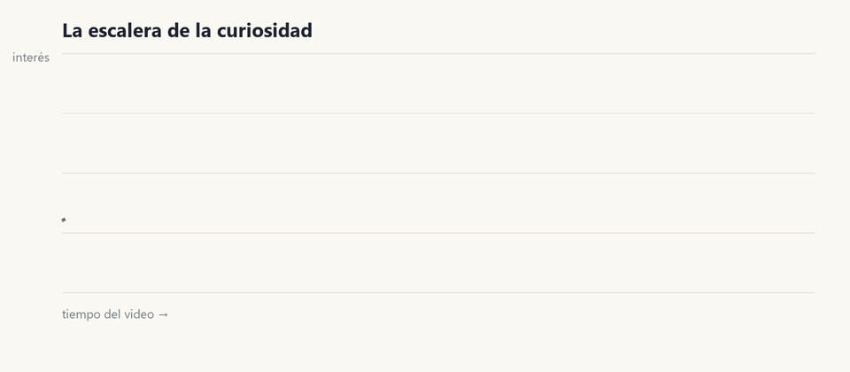
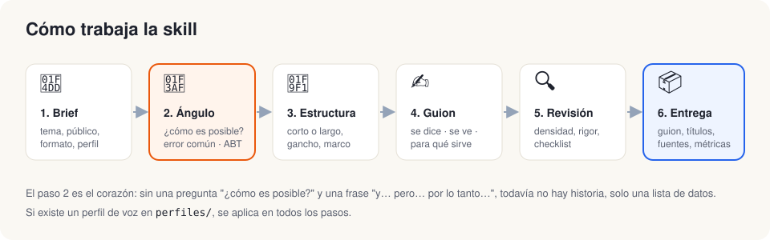
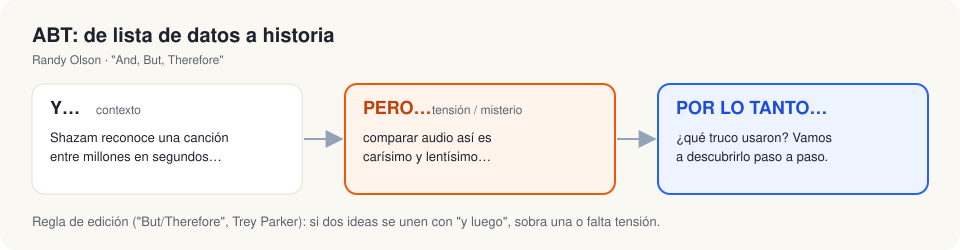

<div align="center">

# 🎙️ divulgacion

**Una skill para Claude que escribe guiones de divulgación que se entienden… y dan ganas de saber más.**

[](https://docs.claude.com/en/docs/agents-and-tools/agent-skills/overview)
[](#)
[](#-corto-vs-largo)
[](LICENSE)



</div>

---

## ¿Qué es?

`divulgacion` es una [Agent Skill](https://docs.claude.com/en/docs/agents-and-tools/agent-skills/overview) que convierte a Claude en un guionista de divulgación de ciencia y tecnología. Sirve para explicar software, IA, matemáticas, física o cualquier tema complejo a un público general, en video **corto** (TikTok, Reels, Shorts) o **largo** (YouTube, charlas, talleres).

No es una lista de "trucos virales". Sale del análisis de más de 50 videos de divulgadores en español e inglés (con métricas reales de TikTok) y de marcos de storytelling probados. Su idea central:

> La estructura es la misma que la del entretenimiento épico, pero el combustible cambia: la tensión no es *"¿lo conseguirá?"*, sino *"¿cómo es posible?"*. La recompensa no es un subidón, es el momento **"¡ya entendí!"**.

## ✨ Qué hace

- **Encuentra el ángulo** antes de escribir: la pregunta "¿cómo es posible?", por qué es difícil, el error común del público y una frase ABT.
- **Escribe el guion** en una tabla de *se dice · se ve · para qué sirve*, con tiempos.
- **Propone 3 títulos o ganchos** honestos (curiosidad, no clickbait).
- **Revisa** con una checklist de densidad, rigor y cierre.
- **Marca los datos por verificar** en lugar de inventarlos.
- **Se adapta a tu voz** mediante perfiles de marca intercambiables.

<p align="center">
  
</p>

## 🚀 Instalación

**Claude Code** (personal, para todos tus proyectos):

```bash
git clone https://github.com/bertohzapata/divulgacion-skill.git
cp -r divulgacion-skill/divulgacion ~/.claude/skills/
```

**Con el CLI de [skills.sh](https://skills.sh):**

```bash
npx skills add https://github.com/bertohzapata/divulgacion-skill --skill divulgacion
```

**Claude.ai / app de escritorio:** descarga `divulgacion.skill` desde [Releases](../../releases) y súbelo en *Configuración → Capacidades → Skills*.

## 💬 Cómo se usa

No hace falta nombrarla: se activa cuando pides explicar un tema técnico, un guion, un gancho o una serie educativa. Por ejemplo:

```text
Hazme un guion de TikTok de 60 s que explique cómo funciona el GPS para gente que no sabe nada de tecnología.
```
```text
Tengo este paper sobre baterías de estado sólido. Conviértelo en un video de YouTube de 12 minutos.
```
```text
Revisa mi guion: siento que es aburrido aunque la información es buena.
```
```text
Dame 5 ganchos para un video sobre por qué la IA "alucina".
```

## 🧭 Principios clave

1. **Desde el espectador.** El gancho habla de su mundo, no de ti ni de tu institución.
2. **Densidad, no velocidad.** Los videos exitosos y los que no despegan hablan igual de rápido (~195 palabras/min); la diferencia es que en los exitosos no hay relleno.
3. **Demuestra antes de explicar**, con una analogía cotidiana por cada concepto difícil.
4. **Empieza por el error común.** Una explicación clara que no toca la intuición equivocada no enseña ([Derek Muller](https://www.youtube.com/watch?v=RQaW2bFieo8)).
5. **Pasión específica:** el detalle exacto que te emociona, no un entusiasmo genérico.
6. **Rigor visible:** datos con fuente, lo aproximado se dice como aproximado, sin miedo como gancho.

<p align="center">
  
</p>

## 📏 Corto vs largo

| | Corto (15–90 s) | Largo (8–40 min) |
|---|---|---|
| Ideas | Una idea, un mecanismo, una analogía | Cadena de 3–6 preguntas |
| Gancho | 0–2 s, desde el espectador | 0–60 s: misterio + promesa cumplida |
| Cuerpo | Promesa → mecanismo → prueba → giro | Escalera con altibajos; algo que recupere la atención cada 2–4 min |
| Cierre | Abrupto: pregunta o serie | Clímax ("¡ajá!") + qué significa para tu vida |
| Qué medir | Guardados y compartidos | % del video visto |

## 🗂️ Estructura

```text
divulgacion/
├── SKILL.md                      # flujo de trabajo y principios
├── references/
│   ├── formato-corto.md          # esqueleto 15–90 s + datos de 21 TikToks
│   ├── formato-largo.md          # escalera, actos, recuperar la atención
│   ├── ganchos.md                # 15 tipos de gancho con ejemplos y métricas
│   ├── marcos-storytelling.md    # ABT, But/Therefore, Story Circle, Kishōtenketsu…
│   ├── referentes.md             # qué aporta cada creador analizado
│   └── checklist.md              # revisión final
├── assets/
│   └── plantilla-guion.md        # plantilla de entrega
└── perfiles/
    ├── _plantilla.md             # crea aquí el perfil de tu canal
    └── ejemplo-canal-tecnologia.md
```

### 🎨 Tu voz, tu perfil

Copia `perfiles/_plantilla.md` como `perfiles/<tu-canal>.md` y describe tu tono, tus públicos, tus valores y tus líneas rojas. La skill lo lee y adapta los ejemplos, las analogías y los llamados a la acción.

## 📚 De dónde sale

Análisis de transcripciones, estructura y métricas de:

- **En español:** Jaime Altozano, Nate Gentile, DotCSV, Guinxu, Fireship, José Luis Crespo (Quantum Fracture), Lord Draugr (sobre la narrativa de Grefg) y 21 TikToks de divulgación.
- **En inglés:** Veritasium, 3Blue1Brown, Mark Rober, Sebastian Lague, Branch Education, Kurzgesagt, Johnny Harris y Tom Scott.
- **Marcos:** ABT de Randy Olson, "But/Therefore" de Trey Parker y Matt Stone, el manual filtrado de producción de MrBeast, *Made to Stick* (Heath), Story Circle (Dan Harmon), Sparkline (Nancy Duarte) y la brecha de curiosidad (Loewenstein).

Los nombres y las referencias se citan con fines educativos; todo el contenido de la skill es una síntesis propia.

## 📄 Licencia

[MIT](LICENSE). Úsala, adáptala y compártela.
